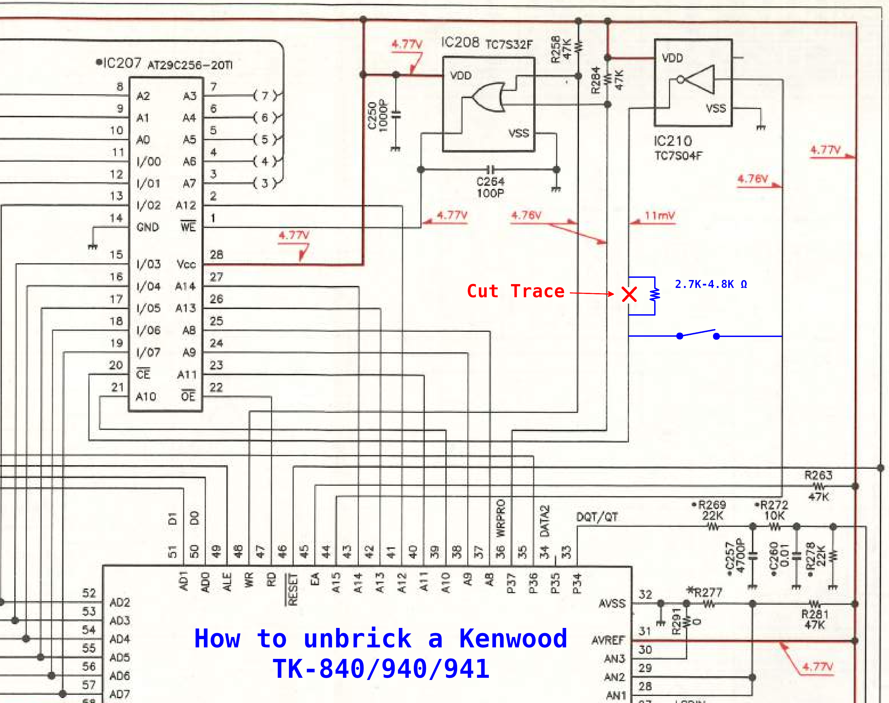
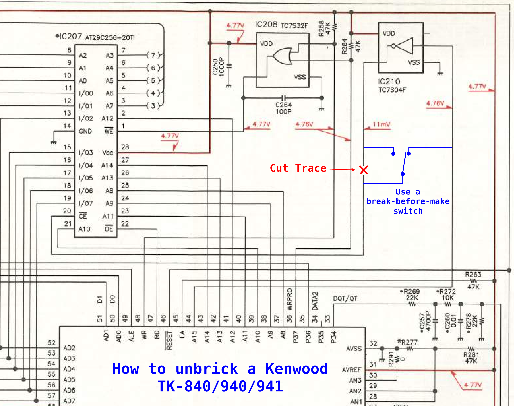

# TK-x4x Hard-Brick Recovery

This document describes hardware recovery for the unusual condition where the application firmware in Flash ROM is unusable **and** firmware loader access is disabled.

It does not describe ordinary recovery from an interrupted or bad firmware write. **A hard brick is extraordinarily unlikely, effectively a near-zero risk in normal firmware programming.** The permanent mask-ROM loader survives even a completely corrupted application image; normal firmware writing requires loader access to be enabled first, so a failed write can simply be reflashed.

## Why a hard brick is difficult to create

The radio's programming system is split into two layers:

1. The CPU's internal mask ROM contains the firmware loader. That loader is the only normal way to program the application firmware in Flash ROM.
2. The application firmware provides normal PROGRAM mode, which can program the channel/configuration area. That area contains the setting that enables access to the mask-ROM firmware loader.

The relationship is:

**Mask ROM loader → programs the firmware → firmware programs the settings.**

The mask-ROM loader cannot change the setting that enables or disables access to itself, and ordinary PROGRAM-mode writes cannot rewrite the application firmware.

**There is also a board-level flash write-enable interlock:** the `P37/WRPRO` gate must be enabled before flash programming can take effect. Even a valid flash erase/program command sequence does not alter the Flash ROM if that gate is not enabled. The resident flash writers explicitly control it; custom code that deliberately calls those writers is not exempt from the normal risk of making changes.

A true software-induced hard brick requires **both** unusable application firmware **and** disabled firmware loader access. Normal programming cannot create that combination. To reach it, severely misbehaving custom firmware would have to change the loader-access setting and leave itself unusable. That is possible in principle, but very unlikely accidentally, even during experimental firmware development.

## Recovery principle

At boot, the mask ROM checks the `KENWOOD` signature at `0xE580-0xE586` in external Flash ROM. If that signature cannot be read correctly, the CPU stays in the resident firmware-loader path instead of entering the application firmware.

The recovery modification temporarily prevents a correct Flash read during boot. Interrupting a Flash data line or a low address line such as A0, A1, or A2 can produce the required bad signature read.

Once `PROGRAM` is flashing, the mask-ROM firmware loader is already running. The Flash connection must then be restored before programming so the loader can access and write the Flash ROM.

The points shown below were chosen because they are practical places to make that temporary interruption. They are not unique recovery signals.

## Method 1: resistor and SPST switch

This version uses a resistor and a simple SPST switch.

With the radio off, **close the SPST switch**, then turn the radio on. Wait until `PROGRAM` is flashing on the display. Once `PROGRAM` is flashing, **open the switch** to restore normal Flash access, then program the firmware normally.

## Method 2: SPDT switch

This version uses a single **break-before-make** SPDT switch.

With the radio off, leave the switch in the position shown in the schematic and turn the radio on. Once `PROGRAM` is flashing, move the switch to the opposite position to restore the Flash connection, then program the firmware normally.

## Scope

This procedure recovers the specific hard-brick state of unusable application firmware plus disabled firmware loader access. It does not repair failed hardware.
